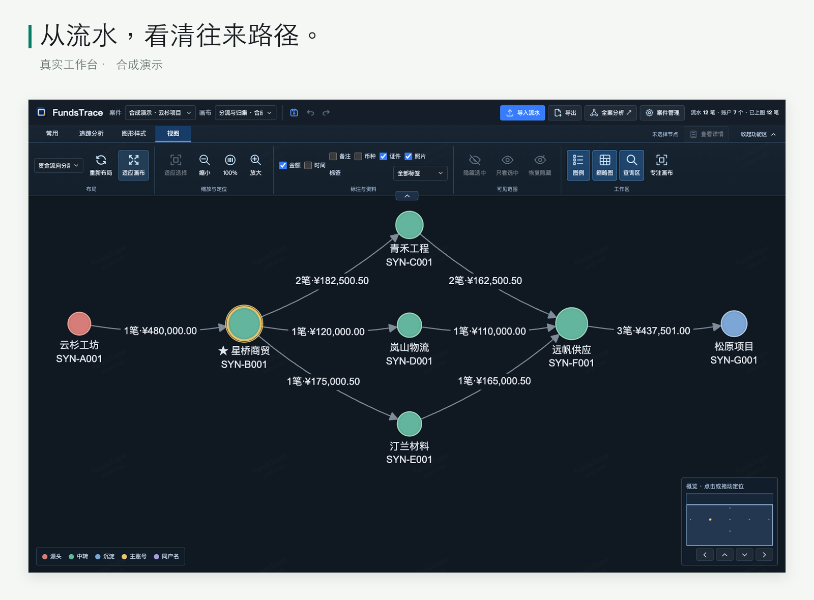
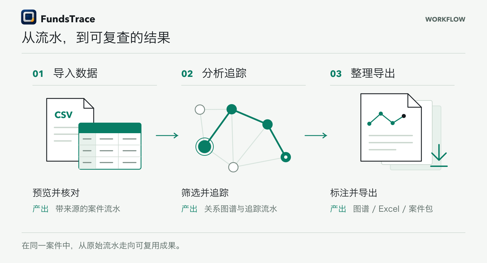
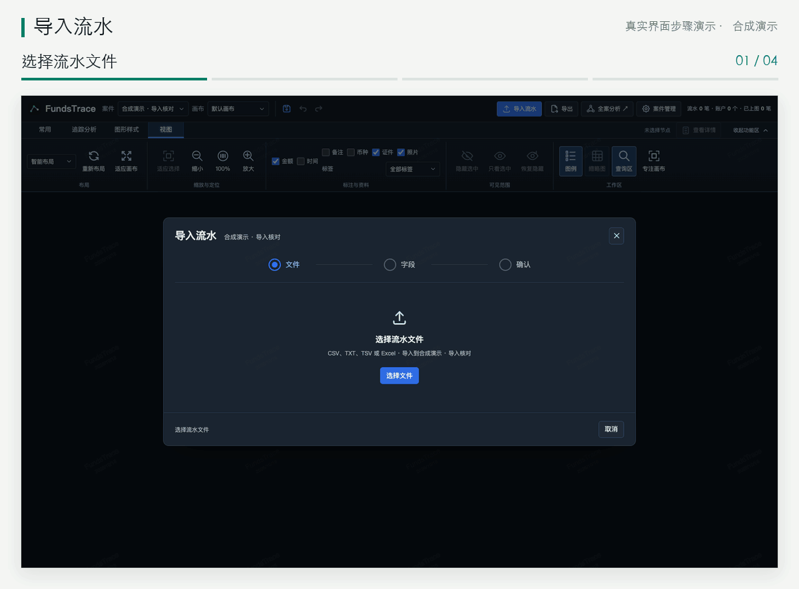
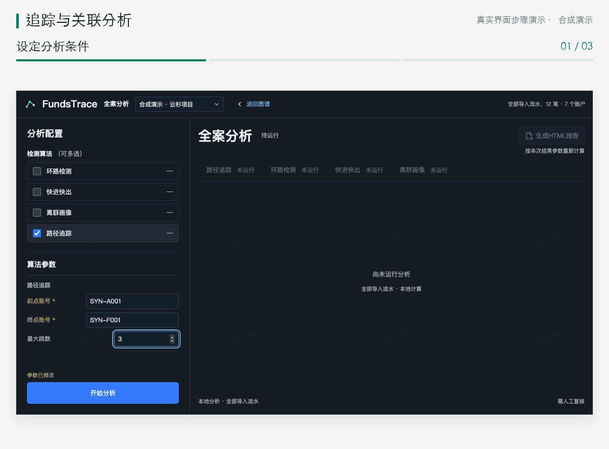
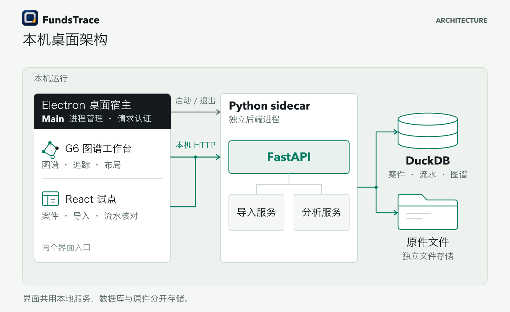

<p align="center">
  <picture>
    <source media="(prefers-color-scheme: dark)" srcset="docs/brand/fundstrace-mark.svg">
    
  </picture>
</p>

<h1 align="center">FundsTrace</h1>

<p align="center"><strong>让资金往来，清晰可见。</strong></p>

<p align="center">本地资金流水追踪与关联分析工具。<br>按案件核对流水，整理图谱、明细与报告。</p>

<p align="center">
  <a href="https://github.com/Eysn0130/FundsTrace/releases/latest"></a>
  <a href="docs/desktop-delivery.md"></a>
  <a href="LICENSE"></a>
  <a href="https://github.com/Eysn0130/FundsTrace/stargazers"></a>
</p>

<p align="center"><strong><a href="https://github.com/Eysn0130/FundsTrace/releases/latest">下载 Windows 版</a></strong> · <a href="#三步走完一次分析">三步上手</a> · <a href="#看看实际操作">操作演示</a> · <a href="docs/workspace-guide.md">使用指南</a></p>

[](docs/media/showcase/workspace-focus.png)

<sub>真实界面 · v0.1.5 源码 · 12 笔合成流水 / 7 个虚构账户。截图来自 macOS Chrome 合成预览，Windows 安装验证范围见[桌面交付](docs/desktop-delivery.md)。</sub>

## 三步走完一次分析

[](docs/media/fundstrace-workflow.png)

1. **导入数据**：新建案件，选择 CSV / XLSX，核对字段与本方账号。
2. **分析追踪**：筛选交易并追踪来源、去向；按需要运行全案分析。
3. **整理导出**：调整布局与标注，保存画布，导出图谱、流水或报告。

[下载合成样例 CSV](docs/examples/harbor-path/fundstrace-synthetic.csv?raw=1) · [XLSX](docs/examples/harbor-path/fundstrace-synthetic.xlsx?raw=1) · [跟做步骤与示例结果](docs/examples/harbor-path/README.md)

## 看看实际操作

### 数据导入：先核对，再入库

选择文件、确认字段、检查预览，再提交导入。导入记录与来源关联保留在当前案件中。

<picture>
  <source media="(prefers-reduced-motion: reduce)" srcset="docs/media/showcase/import-poster.png">
  
</picture>

[查看静态封面](docs/media/showcase/import-poster.png) · [原始界面](docs/media/showcase/import-mapping.png)

### 数据分析：从参数，到可复查的路径

支持环路检测、快进快出、离群画像与路径追踪。下面选择起终点、查看路径，再生成 HTML 报告。

<picture>
  <source media="(prefers-reduced-motion: reduce)" srcset="docs/media/showcase/analysis-poster.png">
  
</picture>

[查看静态封面](docs/media/showcase/analysis-poster.png) · [完整分析界面](docs/media/showcase/analysis-results.png) · [下载示例报告](docs/examples/harbor-path/exports/analysis-report.html?raw=1)

<sub>两段 GIF 直接由本次真实界面截图生成，按步骤停留展示，全部为合成数据。路径金额按交易边累加，非去重本金；分析结果需人工复核，不能据此认定资金用途或交易性质。</sub>

### 图谱整理与结果交付

用布局、拖动、邻域与标注整理关系；多画布保存、撤销与重做帮助逐步推敲。图谱导出 PNG / HTML / PDF，当前画布追踪流水导出 Excel，案件迁移使用 `.fundcase`。

[完整工作台](docs/media/showcase/workspace.png) · [示例图谱](docs/examples/harbor-path/exports/traced-graph.png) · [示例流水 Excel](docs/examples/harbor-path/exports/tracked-flows.xlsx?raw=1) · [各类导出的范围](docs/workspace-guide.md#分析与导出范围)

## 本机运行，职责清楚

[](docs/media/fundstrace-architecture.png)

G6 承载追踪图谱，React / TypeScript 提供案件、导入与流水核对试点；Python / FastAPI 共用业务服务，DuckDB 管理案件数据。金额通过十进制字符串契约保留分位与币种。

[架构与演进](docs/evolution.md) · [金额契约](docs/money-contract.md) · [代码地图](CONTRIBUTING.md#代码地图与兼容性) · [开发贡献](CONTRIBUTING.md)

## 下载与开始使用

从 [GitHub Releases](https://github.com/Eysn0130/FundsTrace/releases/latest) 下载 Windows x64 `.exe`，安装后直接启动，当前 v0.1.x 无需授权码。新版 EXE 支持覆盖安装；卸载默认保留案件数据。当前没有应用内自动更新器。

当前为**未签名预览版**。Win10 / 11 实机 DPI、跨屏与原生保存等仍待人工验收；具体已执行检查以[对应版本报告](docs/desktop-delivery.md)为准。

案件包不含原始上传文件、导入任务或回执；备份应在一致状态下包含完整运行目录。反馈问题时请使用合成复现，避免上传真实案件、身份、账号、照片或授权材料。[数据边界](docs/source-boundaries.md) · [导入与恢复](docs/import-lifecycle.md)

<details>
<summary><strong>从源码运行一次性合成预览</strong></summary>

使用 Python 3.11、Node 22.22.1；完整环境与测试入口见[贡献指南](CONTRIBUTING.md#环境安装与测试入口)。

```sh
uv venv --python 3.11
uv pip sync requirements-dev.lock
npm --prefix frontend ci
npm --prefix frontend run build
.venv/bin/python scripts/preview_synthetic.py
```

预览打印随机本地地址，退出后清除临时数据。普通运行、Electron 开发、测试与契约检查见[开发与贡献](CONTRIBUTING.md)。

</details>

## 文档与参与

[使用指南](docs/workspace-guide.md) · [API 契约](docs/api-contract.md) · [桌面交付](docs/desktop-delivery.md) · [设计验收](design-qa.md) · [性能记录](docs/performance.md) · [品牌与展示素材](docs/brand/README.md) · [素材核验](docs/showcase-validation.md)

欢迎提交带合成复现步骤的 [Issue](https://github.com/Eysn0130/FundsTrace/issues) 或范围清楚的 PR。

[MIT License](LICENSE) · [第三方许可与来源](THIRD_PARTY_NOTICES.md)
