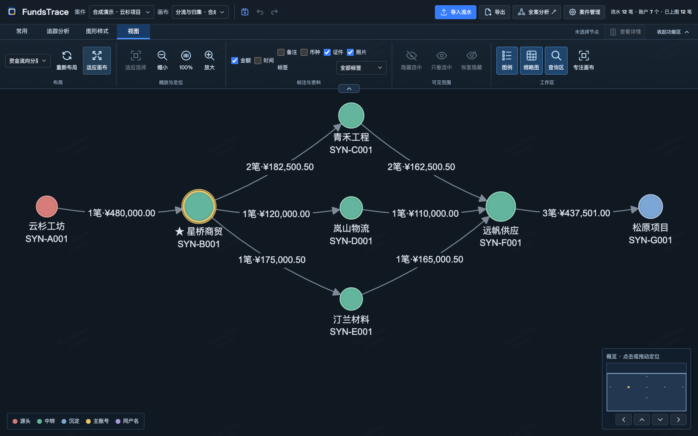

<h1 align="center"><br>FundsTrace</h1>

<p align="center"><strong>让资金往来，清晰可见。</strong><br>本地资金流水追踪与关联分析工具</p>

<p align="center">
  <a href="https://github.com/Eysn0130/FundsTrace/releases/latest"></a>
  <a href="docs/desktop-delivery.md"></a>
  <a href="LICENSE"></a>
</p>

<p align="center"><strong><a href="https://github.com/Eysn0130/FundsTrace/releases/latest">下载 Windows 版</a></strong> &nbsp; · &nbsp; <a href="docs/workspace-guide.md">使用指南</a> &nbsp; · &nbsp; <a href="#看看实际操作">操作演示</a></p>

[](docs/media/showcase/workspace-focus.png)

<p align="center"><sub>产品实景 · 合成示例数据 · <a href="docs/showcase-validation.md">素材说明</a></sub></p>

## 从流水到图谱

下载 [Windows x64 安装包](https://github.com/Eysn0130/FundsTrace/releases/latest)，安装后即可开始。支持覆盖安装，卸载默认保留案件数据。[安装与版本说明](docs/desktop-delivery.md)

1. **导入数据**：新建案件，选择 CSV / XLSX，核对字段与本方账号。
2. **分析追踪**：筛选交易，追踪资金来源与去向，查看账户关系和交易路径。
3. **整理导出**：调整布局与标注，保存画布，导出图谱、流水或报告。

[下载合成样例 CSV](docs/examples/harbor-path/fundstrace-synthetic.csv?raw=1) · [XLSX](docs/examples/harbor-path/fundstrace-synthetic.xlsx?raw=1) · [跟做步骤与示例结果](docs/examples/harbor-path/README.md)

## 看看实际操作

### 导入与核对

选择文件、确认字段、检查预览，再提交导入。导入记录与来源关联保留在当前案件中。

<picture>
  <source media="(prefers-reduced-motion: reduce)" srcset="docs/media/showcase/import-poster.png">
  
</picture>

[查看静态封面](docs/media/showcase/import-poster.png) · [原始界面](docs/media/showcase/import-mapping.png)

### 资金追踪与研判

支持环路检测、快进快出、离群画像与路径追踪。下面选择起终点、查看路径，再生成 HTML 报告。

<picture>
  <source media="(prefers-reduced-motion: reduce)" srcset="docs/media/showcase/analysis-poster.png">
  
</picture>

[查看静态封面](docs/media/showcase/analysis-poster.png) · [完整分析界面](docs/media/showcase/analysis-results.png) · [下载示例报告](docs/examples/harbor-path/exports/analysis-report.html?raw=1)

<sub>示例均为合成数据。路径金额按交易边累加，非去重本金；分析结果需人工复核。</sub>

### 图谱整理与结果交付

调整布局、标注关系，用多画布保存不同的分析视角。图谱可导出 PNG / HTML / PDF，当前画布的追踪流水可导出 Excel，案件可通过 `.fundcase` 迁移。

[完整工作台](docs/media/showcase/workspace.png) · [示例图谱](docs/examples/harbor-path/exports/traced-graph.png) · [示例流水 Excel](docs/examples/harbor-path/exports/tracked-flows.xlsx?raw=1) · [各类导出的范围](docs/workspace-guide.md#分析与导出范围)

## 文档与参与

[使用指南](docs/workspace-guide.md) · [示例数据与操作步骤](docs/examples/harbor-path/README.md) · [开发与贡献](CONTRIBUTING.md)

欢迎提交带合成复现步骤的 [Issue](https://github.com/Eysn0130/FundsTrace/issues) 或范围清楚的 PR。反馈时请勿上传真实案件、身份、账号或照片。案件迁移与完整备份的区别见[案件包说明](docs/import-lifecycle.md#界面与案件包)。

<details>
<summary><strong>开发与架构</strong></summary>

[](docs/media/fundstrace-architecture.png)

G6 承载追踪图谱，React / TypeScript 提供案件、导入与流水核对试点；Python / FastAPI 共用业务服务，DuckDB 管理案件数据。金额通过十进制字符串契约保留分位与币种。

[架构与演进](docs/evolution.md) · [API 契约](docs/api-contract.md) · [金额契约](docs/money-contract.md) · [代码地图](CONTRIBUTING.md#代码地图与兼容性)

[导入与恢复](docs/import-lifecycle.md) · [性能记录](docs/performance.md) · [设计验收](design-qa.md) · [品牌与展示素材](docs/brand/README.md)

</details>

<details>
<summary><strong>从源码运行一次性合成预览</strong></summary>

使用 Python 3.11、Node 22.22.1；完整环境与测试入口见[贡献指南](CONTRIBUTING.md#环境安装与测试入口)。

```sh
uv venv --python 3.11
uv pip sync requirements-dev.lock
npm --prefix frontend ci
npm --prefix frontend run build
.venv/bin/python scripts/preview_synthetic.py
```

预览打印随机本地地址，退出后清除临时数据。普通运行、Electron 开发、测试与契约检查见[开发与贡献](CONTRIBUTING.md)。

</details>

[MIT License](LICENSE) · [第三方许可与来源](THIRD_PARTY_NOTICES.md)
