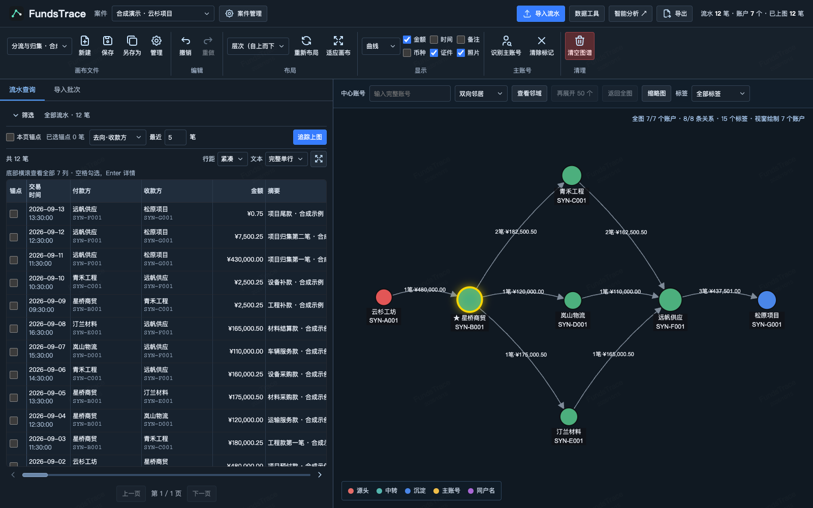
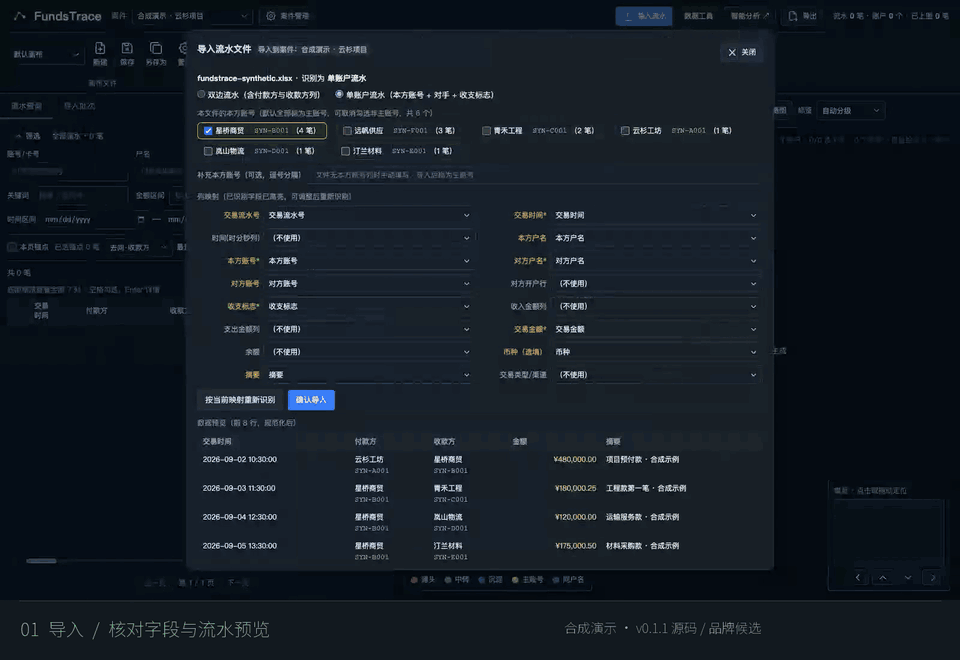

<picture>
  <source media="(prefers-color-scheme: dark)" srcset="docs/brand/fundstrace-wordmark-dark.svg">
  
</picture>

**导入资金流水，追踪往来关系。**

在本地按案件核对流水，从一笔交易延伸往来路径，整理成图谱、明细与报告。

**[下载 Windows 版](https://github.com/Eysn0130/FundsTrace/releases/latest)** · [使用指南](docs/workspace-guide.md) · [开发贡献](CONTRIBUTING.md)

[](docs/media/workspace-hero.png)

<sub>真实工作台 · 12 笔合成流水 / 7 个虚构账户。录制基于 v0.1.1 源码与现用品牌资源；新标识已随 v0.1.2 安装包发布。[查看原图](docs/media/workspace-hero.png)</sub>

<details>
<summary><strong>▶ 观看操作预览：导入 → 追踪 → 整理 → 导出</strong></summary>



12 秒操作节选，全部为合成数据。[下载 31 秒完整演示（MP4）](docs/media/fundstrace-demo.mp4?raw=1) · [下载样例并跟做](docs/examples/harbor-path/README.md)

</details>

[下载 31 秒完整演示（MP4）](docs/media/fundstrace-demo.mp4?raw=1) · [合成样例与复现步骤](docs/examples/harbor-path/README.md)

当前为预览版。已发布 [v0.1.3](https://github.com/Eysn0130/FundsTrace/releases/tag/v0.1.3)，支持 Windows x64，安装后无需授权码；普通账户、中文路径与程序出站阻断已在 Windows Server 验证，Win10／11 系统 DPI、原生保存等仍待实机验收。安装包未签名。[安装与验证范围](docs/desktop-delivery.md)

## 从一份流水，到可复查的结果

### 找到要看的交易

导入 CSV / XLSX，先核对预览、字段映射和本方账号。按账号、户名、对手、金额与日期查询；展开流水全览，逐笔核对完整账号与金额。导入回执和来源记录保留在案件内。

### 顺着往来，整理路径

选一笔交易作为锚点，追踪主账号此前的收入或此后的转出。把相关流水加入画布，用布局、节点拖动、金额标注和邻域视图整理关系；画布可保存、另存，编辑支持撤销与重做。Ctrl／Command 点击可多选并整组移动；1–10 个选中节点用呼吸光圈定位，更多选择保持静态。

追踪按已导入账单与时间关系延伸。图上的连线不代替资金用途、交易性质或法律事实认定。

### 带走图谱，也带走明细

导出当前图谱 PNG、可拖拽 HTML 或 PDF，或导出当前画布的追踪流水 Excel。需要迁移案件时使用 `.fundcase` 案件包；分析页按所选算法生成结果与 HTML 报告。各入口的导出范围见 [使用指南](docs/workspace-guide.md#分析与导出范围)。

## 用一份合成样例走完流程

[云杉项目样例](docs/examples/harbor-path/README.md) 包含 CSV、XLSX、操作步骤及实际导出文件。全部名称、账号、交易与业务背景均为虚构。

1. **导入**：新建专用演示案件，选择样例，确认单账户流水映射。
2. **追踪**：查询 `SYN-PATH-001`，选为锚点，按“去向·收款方”追踪；再在全览中加入完整样例。
3. **整理**：选择布局，调整节点与标注，保存具名画布。
4. **导出**：保存图谱与追踪流水，核对生成文件。

[样例 CSV](docs/examples/harbor-path/fundstrace-synthetic.csv)　/　[样例 XLSX](docs/examples/harbor-path/fundstrace-synthetic.xlsx)　/　[导出的追踪流水](docs/examples/harbor-path/exports/tracked-flows.xlsx)

## 安装与数据

从 [GitHub Releases](https://github.com/Eysn0130/FundsTrace/releases/latest) 的 Assets 下载 Windows x64 `.exe`。使用新版 EXE 覆盖安装；卸载默认保留 `%APPDATA%\FundsTrace` 中的案件数据。当前没有应用内自动更新器。

案件数据由本机 Python 服务与 DuckDB 管理。请在一致状态下备份完整运行目录；案件包不包含原始上传文件、导入任务或回执。不要把真实案件、账号、身份、照片或授权材料提交到公开仓库和问题反馈中。[数据与源码边界](docs/source-boundaries.md) · [导入与恢复](docs/import-lifecycle.md)

## 开发与架构

| 层 | 当前实现 |
| --- | --- |
| 案件与流水 | Python / FastAPI 统一业务与持久导入服务，DuckDB 保存案件数据 |
| 追踪工作台 | JavaScript / G6 图谱；React / TypeScript 案件、导入与流水核对试点 |
| 桌面运行 | 独立 Electron 宿主与所属 Python sidecar，保留本机服务请求认证 |

独立桌面与浏览器共享业务服务；React 共享面板的宿主接入仍属研究，尚未接入 Analytix。金额通过十进制字符串契约保留分位与币种，显示和导出范围各自明确。[金额契约](docs/money-contract.md) · [代码地图与兼容性](CONTRIBUTING.md#代码地图与兼容性)

使用 **Python 3.11、Node 22.22.1**。首次设置按 [贡献指南](CONTRIBUTING.md#环境安装与测试入口) 安装依赖；构建后可启动一次性合成预览：

```sh
uv venv --python 3.11
uv pip sync requirements-dev.lock
npm --prefix frontend ci
npm --prefix frontend run build
.venv/bin/python scripts/preview_synthetic.py
```

预览打印随机本地地址，退出后清除临时数据。普通运行、Electron 开发、测试与契约检查见 [开发与贡献](CONTRIBUTING.md)；Windows 构建和发布边界见 [桌面交付](docs/desktop-delivery.md)。

## 文档与参与

[工作台指南](docs/workspace-guide.md) · [导入生命周期](docs/import-lifecycle.md) · [API 契约](docs/api-contract.md) · [设计验收](design-qa.md) · [性能记录](docs/performance.md) · [品牌资产](docs/brand/README.md) · [展示素材与核验](docs/showcase-validation.md)

欢迎提交带合成复现步骤的 [Issue](https://github.com/Eysn0130/FundsTrace/issues) 或范围清楚的 PR。开发规范、主题文档索引与历史接管记录见 [CONTRIBUTING.md](CONTRIBUTING.md)。

[MIT License](LICENSE) · [第三方许可与来源](THIRD_PARTY_NOTICES.md)
