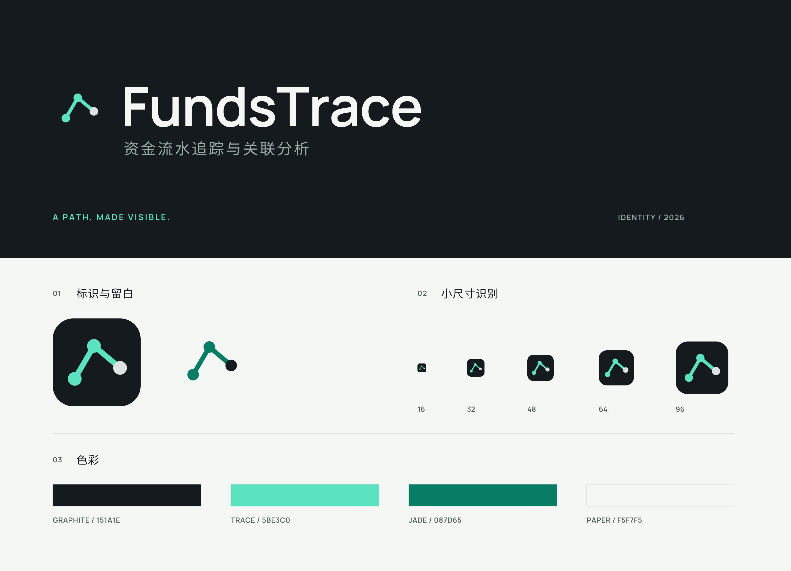

# FundsTrace 品牌资产

标识沿既有节点连线语义精修：去掉闭合三角形，让起点、转折与终点组成一条开放的追踪路径。主品牌名为 **FundsTrace**，中文说明为 **资金流水追踪与关联分析**。图形、字体轮廓与应用资源均可独立使用；此目录不包含产品截图或模拟界面。



## 选用资产

| 用途 | 文件 | 规格 |
| --- | --- | --- |
| GitHub README 深色主题 | [深底字标](fundstrace-wordmark-dark.svg) | 1080 × 190，文字已转路径 |
| GitHub README 浅色主题 | [浅底字标](fundstrace-wordmark-light.svg) | 1080 × 190，文字已转路径 |
| 外部排版 | [深底用透明字标](fundstrace-wordmark-transparent-dark.svg)、[浅底用透明字标](fundstrace-wordmark-transparent-light.svg) | 1080 × 190，无背景 |
| 图形单独使用 | [深底用透明标识](fundstrace-mark.svg)、[浅底用透明标识](fundstrace-mark-light.svg) | 64 × 64 原生矢量 |
| 应用图标 | [图标源](fundstrace-icon.svg)、[Windows ICO](icons/icon.ico) | 石墨底；ICO 含 16、32、48、64、128、256 六档 |
| PNG 导出 | [16](icons/icon-16.png)、[32](icons/icon-32.png)、[48](icons/icon-48.png)、[64](icons/icon-64.png)、[128](icons/icon-128.png)、[256](icons/icon-256.png)、[512](icons/icon-512.png)、[1024](icons/icon-1024.png) | RGBA，圆角外透明 |
| 品牌板 | [SVG](brand-board.svg)、[PNG](brand-board.png) | SVG 1440 × 1040；PNG 2880 × 2080 |
| 可编辑字标 | [深底源](source/wordmark-dark-editable.svg)、[浅底源](source/wordmark-light-editable.svg) | 保留 SVG text；编辑时需安装下述字体 |

深浅字标另有同名 PNG（2160 × 380），适用于不接受 SVG 的场景。正式 SVG 使用轮廓路径，无脚本、外部资源、位图或字体加载依赖。保持原比例，图形周围至少留出一个节点直径的空白；小于 32px 时使用图形，不附加中文或缩写。

## 色彩与字体

| 色彩 | 值 | 用途 |
| --- | --- | --- |
| Graphite | `#151A1E` | 品牌底与浅底主字色 |
| Trace | `#5BE3C0` | 深底追踪路径 |
| Jade | `#087D65` | 浅底追踪路径，浅底对比度 4.72:1 |
| Paper | `#F5F7F5` | 浅色背景与深底主字色 |
| Mist | `#99AAA6` | 深底中文说明，对比度 7.22:1 |

英文字标使用 [Manrope](https://github.com/google/fonts/tree/b31870aff700ab7a1d74fa0c6887d95beb9e0037/ofl/manrope) 650 字重；中文使用 [Noto Sans SC](https://github.com/google/fonts/tree/a85815a42757630ce188fdad368c2dfc444d4773/ofl/notosanssc) 400 字重。两者均使用 SIL Open Font License 1.1；版权和完整许可证分别保留在 [Manrope-OFL.txt](licenses/Manrope-OFL.txt)、[NotoSansSC-OFL.txt](licenses/NotoSansSC-OFL.txt)。字体二进制没有加入本仓库。字标是使用字体生成的图形文档，字体本身的 OFL 许可仍独立保留。

图形与排版由本仓库原生 SVG 及生成脚本绘制，随项目 MIT 许可提供；未复制外部产品的标识或品牌图片。

## 重建

[generate.py](generate.py) 是字标轮廓与图形的统一生成源；[render.mjs](render.mjs) 从这些 SVG 导出 PNG 和 Windows ICO。已验证环境：fontTools 4.67.0、sharp 0.35.5。ICO 检查使用 Pillow 12.3.0。生成流程没有调用图片生成服务。

从上述固定版本的字体目录下载 `Manrope[wght].ttf` 与 `NotoSansSC[wght].ttf` 到独立的临时目录（不要把完整字体加入提交），传入实际路径：

```sh
python docs/brand/generate.py --latin-font /path/to/Manrope.ttf --cjk-font /path/to/NotoSansSC.ttf
BRAND_SHARP_PATH=/path/to/node_modules/sharp node docs/brand/render.mjs
```

`BRAND_SHARP_PATH` 可省略，此时使用正常 Node 模块解析。脚本核对字体 SHA-256，拒绝与当前轮廓来源不同的输入：

```text
Manrope.ttf     3ae11c49db0455a3cc33e37d380f20fdb8c7f8b41dc07625c177e3d87a9d6ae6
NotoSansSC.ttf  a3041811a78c361b1de50f953c805e0244951c21c5bd412f7232ef0d899af0da
```

重建会同步 `static/logo.svg`、`static/favicon.svg`、`desktop/assets/icon.ico` 与 `desktop/assets/icon.png`。源文件保留真实的圆、路径、填色与字距，设计调整先改生成源，再重新导出。

## 桌面集成边界

`desktop/electron-builder.cjs` 仅增加 `win.icon`，指向 `desktop/assets/icon.ico`。appId、产品名、版本、数据目录、安装和卸载行为没有更改。图标资源已进入本支线源码候选；已公开的 **v0.1.1 二进制不包含本轮新品牌资产**。本轮没有重打包、替换 Release 文件或验证新图标在 Windows 安装器、任务栏、系统缩放中的实际表现。后续正式包需在其自身构建和 Windows 安装证据中核对图标。
