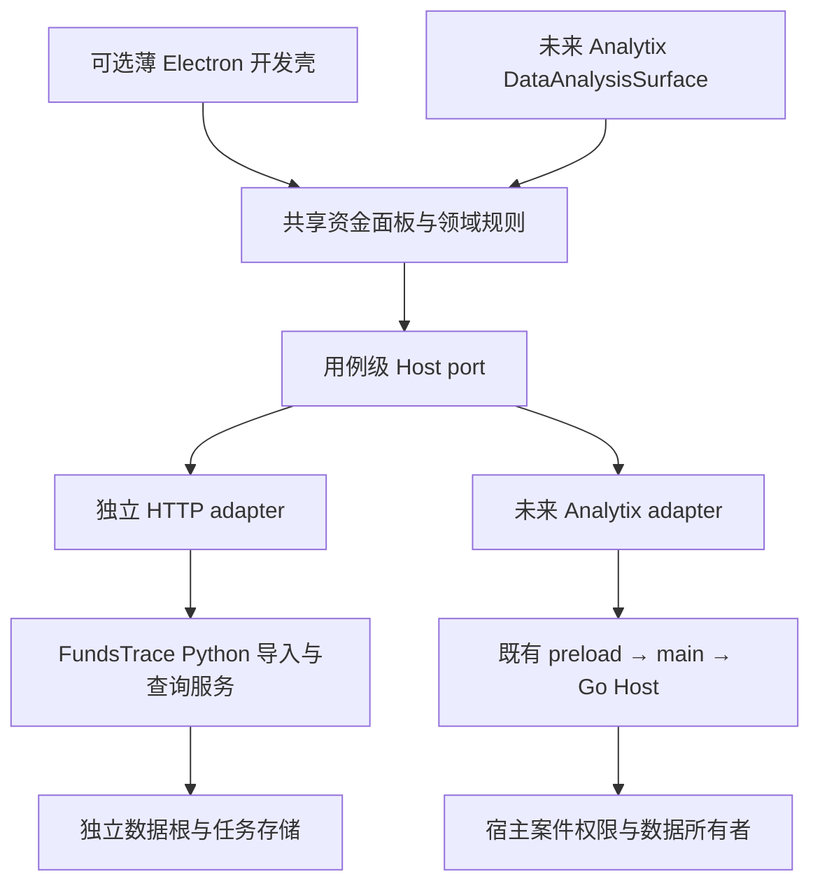

# Electron 开发壳与 Analytix 接入边界

> **当前状态更新（2026-10-15）：** 独立 Electron／Python sidecar 已施工，Windows x64 原生安装器构建及包内后端烟测已通过，运行与证据层级以 [desktop-delivery.md](desktop-delivery.md) 为准。下面保留此前研究上下文；“未增加壳／未安装”等表述仅描述当时阶段。Windows GUI 未实机验收，Analytix 未修改或接入。

状态：**Electron 路线为 Reference／研究建议；FundsTrace 共享面板为本地源码候选**。Analytix 源码核对日期：2026-10-14。没有修改、启动或构建 Analytix，没有安装 Electron 或制作安装包。本文补充 [analytix-integration.md](analytix-integration.md)，不代表宿主接入已经完成。

## 结论与范围

可以让 FundsTrace 使用与 Analytix 相同的 **Electron＋React＋TypeScript 技术路线**。更合适的方式是先保持 FundsTrace 的独立开发与数据所有权，再按实际桌面需求增加一个很薄的独立 Electron 开发壳；以后由 Analytix 加载共享 React 面板并提供 Host adapter，独立壳可以继续保留，也可以退出集成版本。

不建议把 Analytix 当前 Electron 工程整体复制成 FundsTrace 的基础。真正降低未来整合成本的是稳定的面板／Host 契约、生命周期及数据所有者边界。使用同一个 Electron 大版本、复制一个窗口或 iframe，并不会自动统一这些边界。这是基于下述源码与官方文档的工程判断；没有做两种壳的包体、启动时间或安装兼容实验。

本轮已将前端按 `panel/`、`adapters/` 与独立外壳划分，建立案件绑定、撤销及可选图谱／下载动作。它减少了浏览器 URL 与面板的耦合；当前仍是独立产品 UI port，未实现 Analytix adapter、Core protected display 或 Electron 壳。接口、原业务功能覆盖和分阶段桌面清单见 [前端宿主适配](frontend-host-adaptation.md)。本文件不将源码抽离写成宿主运行或发行证明。

## 当前核对事实

- Analytix 本地 `main` 的 HEAD 仍为 `c7d2a370855a8d371c61c32cc2422515b9404ef2`。相关 README、Electron main／identity／preload、数据分析边界及 Workbench 在本次 `git diff --name-only HEAD -- <核对路径>` 中没有差异。工作树另有无关未提交修改，均保留。以下链接固定到该 commit，不会自动证明后续 main 的状态。
- Analytix 的 main 不只是开一个窗口：它在启动时配置身份与 `userData`，处理旧状态迁移和单实例门槛，再组装 runtime、设置及其他桌面能力。[启动与迁移](https://github.com/Eysn0130/analytix/blob/c7d2a370855a8d371c61c32cc2422515b9404ef2/src/main/index.ts#L360-L421)。其身份为 `analytix`／`com.analytix.desktop`，有自身的协议注册。[身份](https://github.com/Eysn0130/analytix/blob/c7d2a370855a8d371c61c32cc2422515b9404ef2/src/main/app-identity.ts#L12-L39)、[打包配置](https://github.com/Eysn0130/analytix/blob/c7d2a370855a8d371c61c32cc2422515b9404ef2/electron-builder.config.cjs#L109-L118)。直接复制会继承这些需要逐项拆除和验证的耦合。
- 当前窗口显式设置 `contextIsolation: true`、`sandbox: true`，preload 按方法暴露 `window.analytix.dataAnalysis`。[窗口](https://github.com/Eysn0130/analytix/blob/c7d2a370855a8d371c61c32cc2422515b9404ef2/src/main/index.ts#L1583-L1602)、[preload](https://github.com/Eysn0130/analytix/blob/c7d2a370855a8d371c61c32cc2422515b9404ef2/src/preload/index.ts#L796-L818)。现存 webview 是另有授权和守卫的预览用途，不是资金功能的通用插件入口。[预览守卫](https://github.com/Eysn0130/analytix/blob/c7d2a370855a8d371c61c32cc2422515b9404ef2/src/main/index.ts#L578-L607)
- 数据分析 IPC 要求已登记主 frame，绑定 renderer 与 backend generation；当前 backend 固定处于 `data_analysis_native_authority_unavailable`，`ensureBackend()` 不启动 Python，`request()` 直接失败。[IPC](https://github.com/Eysn0130/analytix/blob/c7d2a370855a8d371c61c32cc2422515b9404ef2/src/main/data-analysis/ipc.ts#L24-L45)、[失败关闭](https://github.com/Eysn0130/analytix/blob/c7d2a370855a8d371c61c32cc2422515b9404ef2/src/main/data-analysis/backend-manager.ts#L323-L337)、[请求入口](https://github.com/Eysn0130/analytix/blob/c7d2a370855a8d371c61c32cc2422515b9404ef2/src/main/data-analysis/backend-manager.ts#L458-L477)。因此现在加个侧栏或加载本地网页，不构成可用的宿主能力。
- 既有 Workbench 按 `workspaceRoot`／`itemId` 懒加载 `DataAnalysisSurface`，这是后期共享面板的候选位置。[导航](https://github.com/Eysn0130/analytix/blob/c7d2a370855a8d371c61c32cc2422515b9404ef2/src/renderer/src/components/Workbench.tsx#L2900-L2909)、[面板](https://github.com/Eysn0130/analytix/blob/c7d2a370855a8d371c61c32cc2422515b9404ef2/src/renderer/src/components/Workbench.tsx#L3560-L3570)。它不是本轮已实施的扩展注册机制。
- FundsTrace 的 [App](../frontend/src/App.tsx) 保留独立案件侧栏、浏览器 URL 和入口组装；[FundsPanel](../frontend/src/panel/FundsPanel.tsx) 接收 [版本化 UI port](../frontend/src/panel/host.ts)，由 [HTTP adapter](../frontend/src/adapters/http.ts) 绑定案件。图谱导航和来源下载通过可选动作注入。当前 API DTO 仍包含本地原值；该抽离不是 Analytix 受保护显示合同，也没有建立真实宿主授权。

## 三条路线的取舍

| 路线 | 并行开发与升级 | 案件／数据所有者 | 建议 |
| --- | --- | --- | --- |
| 复制 Analytix 整套 Electron 工程再改名 | 需要剥离 runtime、Provider、迁移、设置、更新与桌面身份；以后维护两份主进程，合并上游变化容易把无关能力带进来。若同身份／路径还可能争用进程和状态。 | 会带来第二套宿主状态与潜在存储权威；不能靠改产品名消除。 | 当前不采用。源码参考必须保留来源与许可；不直接拷贝启动入口。 |
| FundsTrace 独立薄 Electron 开发壳＋可共享面板／Host port | 两个项目可以各自迭代、单独退出和升级。壳只负责窗口、受限文件入口及自有 Python 子进程生命周期；共享包按明确版本验证。 | 独立模式由 FundsTrace Python 服务拥有自己的数据根；不打开 Analytix active-case 库。 | 有明确桌面需求时的中间路线。本轮只留接口边界，尚未创建壳。 |
| 最终共享面板挂入 Analytix 既有工作区 | 面板复用宿主布局、窗口、菜单与发行链；后续需要宿主与面板的兼容矩阵。移除独立案件侧栏和浏览器 URL 假设。 | Host 绑定当前案件、权限、快照及唯一数据所有者，FundsTrace 提供领域用例和 UI。 | 长期优先路线，必须等相关 Host 能力可用后逐个用例接入。 |

同技术栈不要求两个项目永远锁在同一个 Electron 版本。共享 React 包须声明并验证其 React／TypeScript／Host 协议兼容范围；Electron 壳分别锁定依赖并安排安全升级。Electron 官方也建议持续更新并逐个主版本处理 breaking changes。[安全与升级](https://www.electronjs.org/docs/latest/tutorial/security#16-use-a-current-version-of-electron)

## 最小实施边界

图中两条 adapter 路线是两种运行模式。一项用例只选择一个存储所有者，不后台双写，也不让两个程序并行打开同一 active-case 数据库。宿主未提供能力时返回明确不可用，不静默切回 Python 直连库。独立模式保留自身兼容格式；未来迁移采用显式版本化导出／导入、来源核对与切换，不把共享磁盘路径当整合方案。数据引擎和 Privacy Layer 的详细边界见 [analytix-integration.md](analytix-integration.md)。

下面是职责界限。当前前端 UI port 以 [host.ts](../frontend/src/panel/host.ts) 为准；更完整的 Electron／Analytix 职责仍是目标，不是已经接受的新 IPC schema：

| 边界 | 拥有者与最小合同 |
| --- | --- |
| 案件上下文 | 独立外壳选择本地案件；嵌入时由宿主提供 opaque context 引用与失效通知。面板不构造授权，不自行写宿主案件绑定。切换或撤销时取消查询、释放订阅并清除旧案显示。 |
| 导入与恢复 | Python 统一应用服务拥有上传会话、映射、提交、任务状态、失败恢复与留存策略，legacy/v1 只是路由 adapter。任务／上传／来源引用必须按案件验证；来源摘要、原始行定位和错误状态可以版本化暴露，文件路径不进入通用契约。 |
| 来源与文件 | 独立服务验证源文件引用及留存状态；最终 Host 模式接收宿主批准的来源 handle。渲染器不得把任意路径包装成 source authority。原文件被清理后，来源摘要保留并明确标注不可再打开，不伪称原件仍在。 |
| React 面板 | 接收上下文、用例 client、导航／图谱动作与生命周期。独立案件选择器、品牌导航、浏览器 history 属于外壳。金额和 ID 继续保持字符串。 |
| G6 | 保留图引擎。先由外壳导航到已有图页；真正嵌入时再把图谱控制器封装为接受有界数据、创建／更新／销毁的组件，不复制一套资金聚合语义。 |
| 敏感显示 | 独立原值 DTO 不直接移入 Analytix store／preload。宿主 adapter 需要 safe view model、可撤销引用及 Core protected display slot；Provider、日志、聊天、普通持久化不接收原始账户／身份。 |

源码已按实际依赖建立 `frontend/src/panel/`、`frontend/src/adapters/` 和独立外壳入口；进一步抽包仍须两个真实消费者证明需求。当前没有创建通用插件框架或第二套 Agent runtime。面板 CSS、弹层、缩放、键盘及缺少宿主动作的验收边界见 [适配清单](frontend-host-adaptation.md#分阶段清单)。

## 若后续增加独立 Electron 开发壳

这部分是明确的后续实施／验收范围，本轮没有执行：

1. 使用 FundsTrace 独立的开发身份、`userData`、`sessionData`、日志、单实例范围及 `FUND_DATA_DIR`。不用 `analytix` 身份、协议、目录、设置或密钥服务；不加载其主进程模块。Electron 的浏览器数据默认位于 `userData`，覆盖 session 路径须早于 ready。[app 路径](https://www.electronjs.org/docs/latest/api/app#appgetpathname)。session partition 只隔离浏览器会话，不隔离 Python DB、日志或文件系统。[session](https://www.electronjs.org/docs/latest/api/session#sessionfrompartitionpartition-options)
2. 壳只启动自己创建并持有句柄的 Python 进程，采用独立 loopback endpoint、明确就绪握手、进程退出／故障状态和有界日志。不得猜端口接管已有进程，或使用全局 `killall` 退出。先用临时合成运行根验收重启和关闭；正常退出 hook 无法代替崩溃／断电后的任务恢复。
3. 把本地服务也当有权限的边界。浏览器 UI 与 Electron 不因 localhost 自动可信；新壳需要明确每次运行的进程／请求授权、来源限制与 sender 校验，且不能把运行授权放进 URL／前端持久化或日志。本轮 standalone v1 API 不被宣称为已具备这个桌面 admission 合同。
4. Renderer 保持 `nodeIntegration: false`、`contextIsolation: true`、`sandbox: true`、`webSecurity: true`，定义严格 CSP；拒绝非允许导航、新窗口和默认权限。preload 每个用例暴露一个有类型的方法，main 核验 sender/frame、参数及当前上下文，禁止通用 `ipcRenderer`、任意 URL 代理、SQL、路径或命令执行入口。[Electron 安全边界](https://www.electronjs.org/docs/latest/tutorial/security)、[IPC 设计](https://www.electronjs.org/docs/latest/tutorial/ipc)、[contextBridge](https://www.electronjs.org/docs/latest/api/context-bridge)
5. 页面资源正式分发时评估受限 custom protocol；调试使用 localhost 必须与正式资源／授权方案分开验证。不能为复用当前相对 API 路径而关闭 webSecurity 或放开全部 CORS。版本、依赖许可、Python runtime、签名、安装升级与卸载数据保留另验。

开发壳降低的是工程耦合，不能仅凭这些配置宣称强 OS 隔离。验收至少应覆盖两个开发环境同时运行但无共享根、单独退出不影响另一方、跨案及失效上下文拒绝、重复恢复不重复导入、源文件清理不能删除活动任务文件、异常退出能识别待恢复任务。正式安装／发行证据不能用 API 回归替代。

## 嵌入网页的备选位置

若短期确实需要在 Analytix 窗口展示独立版，可以单独评估 iframe／`WebContentsView` 过渡试点；它仍要解决服务启动、授权、frame principal、文件选择、焦点、窗口、资源和升级，不是零成本桥梁。当前 Analytix 主 frame 检查不会给嵌入网页自动授权。

Electron 官方不建议新增 `<webview>` 依赖；`WebContentsView` 由 main 管理，和 DOM 布局协调也有成本。[Web Embeds](https://www.electronjs.org/docs/latest/tutorial/web-embeds)。因此不把现有预览 webview 直接扩为资金插件。最终仍优先由既有 React surface 加载共享面板；临时嵌入不可替代正式 Host 合同。

## 未验证与重新核对点

本轮没有读取 Analytix 业务库、真实 case binding、凭据、Provider 配置、受保护运行状态或历史会话；没有运行其 GUI、Python 服务、Go/Rust 引擎、测试、构建或打包。没有验证 installed capability、完整 Privacy Layer、内存／进程隔离、安装升级或发行资格。

开始任何 Analytix 实施前，重新核对 HEAD、适用规范、dirty overlap、Host 能力和 accepted target。独立开发不要求冻结 Analytix；每次升级只针对已声明的 Host 合同和面板交互作兼容验证，不能把本次固定 commit 的研究结论当未来候选验收。
