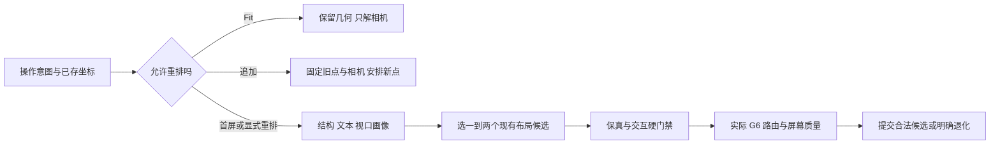

# 图谱首屏展示 P0：研究结论、边界与下一阶段施工计划

日期：2026-10-16。本文记录研究依据、已落地的统一布局保护和后续质量边界；未引入新布局引擎，也不代表已达到通用性能目标。本轮保留 G6 4.8.19、五种既有布局、顶栏及画布面积；先修现有交互与几何缺陷。

## 1. P0 的目标与操作边界

目标是让办案人员尽快找到关注账户，看清资金汇入、流出和回流，沿箭头追踪指定链路并读清关键金额。截图整齐、全图塞进一个矩形、节点均匀分散都不能单独证明目标达成。

| 操作 | 可以改变 | 必须保持 |
| --- | --- | --- |
| 无有效已存坐标的首屏 | 节点位置、布局候选、相机 | 全部图谱事实；主账号来自业务设置，不能由几何中心推断 |
| 显式重新布局 | 当前范围的坐标、自动路线、相机 | 金额、方向、成员和人工几何契约；一次可撤销操作 |
| 适应画布 | 相机、最终标签显示级别 | 所有节点坐标、人工折点与标签路径比例；重复适配稳定 |
| 追加／继续展开 | 新点坐标及其连接 | 全部旧坐标和相机；不自动缩小、不把新点塞回旧核心 |
| 手动拖动 | 用户选定节点／连线几何 | 后台布局、迟到点击或标签刷新不得回写；只结算一次历史 |
| 保存重开 | 恢复已存几何和样式、按原规则适配相机 | 不再为“更漂亮”重新选择布局；快照坐标沿用两位小数契约 |
| 导出 | 按明确范围采样或生成离线文档 | 原方向、精确币种金额、标签所属关系；采样结束恢复交互画布 |

固定下方标签是一个锚点，6 CSS px 位于实际主体屏幕包络之外；关系文字是本线中段，简单水平关系可上置，其余中段留缝。标签均为纯文字。任何布局都无权自行改变这些规则。复杂图仍可能有文字遮挡；不能用文字漂移、删关系或偷偷重排掩盖空间不足。

## 2. 一手研究说明了什么

本次引擎工作流使用 Exa 检索 25 个结果槽位，并完整核读 11 个去重官方 URL；可读性工作流另核读 8 个去重研究来源，其中 7 个取得全文、1 个仅取得出版方摘要／要点。后者的 Exa 调用不可用，失败结果没有计为已审阅来源，改按本次用户授权直接核对作者、大学和出版方原文。下文区分文献事实与本项目建议，数量不代表穷尽全部图绘制研究。

### 2.1 节点数不是可读容量，也不是布局选择的充分条件

[复杂性综述](https://arxiv.org/html/1809.00270)统计了 152 项研究，并指出常用整数规模和不完整的可见规模报告不足以建立普遍认知上限。[Ghoniem 等的比较实验](https://mohammad.ghoniem.info/research/ivs-usability-2005.pdf)使用特定图、规模、密度和任务；邻接查找与路径追踪的结论不同。不能把某个实验的 20、50 或 100 节点搬成 FundsTrace 的产品限制。

同为 24 个节点，可以是 23 边链、23 边星形、平衡树、环、四个稠密局部块或完全二部结构；它们需要解决的是层深、扇出、循环、跨区连接或无法消除的交叉。节点数主要提示计算成本，布局建议还需要结构、文本尺寸和视口。

### 2.2 交叉少不等于关系容易追踪

[Huang 的眼动研究](https://arxiv.org/html/0810.4431)表明，小交角会增加路径追踪的反复确认，定位节点则是另一类任务；该实验样本和图样有限，交叉数与交角也有混杂边界。因此应同时检查锐角交叉、共线重叠、边穿非端点节点、节点附近拥挤、箭头可见性和长边，而不能只统计端点直线的交叉数。最终显示的是 G6 曲线，质量测量也应面对实际曲线。

### 2.3 稳定与重新整理是两种任务

[动态图定位研究](https://www.researchgate.net/publication/232747172_Mental_Map_Preservation_Helps_User_Orientation_in_Dynamic_Graphs)支持稳定位置对定位／路线任务的价值；[后续综述与实验讨论](https://www.sciencedirect.com/science/article/pii/S107158191300102X)也指出已有结论具有任务依赖性，不能推导“任何图永远不动最好”。追加保留旧点是当前用户明确契约；显式重新布局允许用户主动交换稳定性与整理收益，二者不能混用。

[DynaDAG](https://graphviz.org/documentation/NW01.pdf)研究增量分层及位置稳定与布局改善之间的取舍；[Grouse](https://www.cs.ubc.ca/labs/imager/tr/2007/Archambault_Grouse_EuroVis/grouseEvis.pdf)和[TopoLayout](https://www.cs.ubc.ca/labs/imager/tr/2006/Archambault_TopoLayout_TVCG/TVCG-0215-1205.R1-TopoLayout.pdf)展示按拓扑分解、局部布局和按需探索的路线。这些图样不是已实现的资金语义或社区识别。

### 2.4 有限画布不能保证全图所有字同时可读

给定可用矩形宽高 W、H，图谱完整包络宽高 Bw、Bh，概略全图倍率受 `min(W/Bw, H/Bh, 最大倍率)` 限制。若文字世界字号为 f，可读屏幕字号目标为 p，则需要 `zoom >= p/f`。两个条件无公共解时，更换布局名称不能消除这项空间矛盾。

p 必须根据指定显示器、DPI、视距和用户任务测量；本文不把某个字号设为已经验证的产品阈值。多行文字、节点强调尺寸、角落图例／缩略图和视口长宽比都改变容量；6 CSS px 固定间距也会随缩放改变世界占位。

因此产品应明确区分全图概览和关注区域阅读。用户选择“全部标签”时保留文字；空间不足如实提示。默认分级只改变标注细节，不得未经操作过滤账户或关系。[Shneiderman 的任务框架](https://www.cs.umd.edu/users/ben/papers/Shneiderman1996eyes.pdf)提供概览、缩放过滤、详情与历史的组织方式，不提供本产品节点容量上限。

## 3. 成熟实现的可借鉴能力与限制

| 实现／原文 | 已核实能力 | 对 FundsTrace 的边界 |
| --- | --- | --- |
| [ELK Layered](https://eclipse.dev/elk/reference/algorithms/org-eclipse-elk-layered.html)、[五阶段说明](https://eclipse.dev/elk/blog/posts/2025/25-08-21-layered.html) | 破环、分层、交叉排序、坐标、路由；支持边标签、端口、多边、自环；长边虚拟节点参与排序 | 当前自研流向分层不等同完整 ELK；上游路由须适配已确认的右弧／留缝，不能直接覆盖 |
| [ELK 交互约束](https://eclipse.dev/elk/blog/posts/2023/23-01-09-constraining-the-model.html)、[elkjs](https://github.com/kieler/elkjs) | 模型顺序与交互坐标约束、Worker；部分交互约束需调用方第二轮求值／伪坐标 | 支持交互选项不等于旧点硬固定；Worker 不等于截止时间；只输出几何，不负责交互／样式 |
| [Dagre](https://github.com/dagrejs/dagre/wiki)、[Graphlib 模型](https://github.com/dagrejs/graphlib/wiki/API-Reference) | 节点及关系标签尺寸、层距、rankdir、边路径；多边需显式 multigraph 与唯一边名 | 适合方向性明显的图，不承诺所有图最少交叉或稳定增量；当前名为 dagre 的自研路径不代表已调用该依赖 |
| [WebCola](https://ialab.it.monash.edu/webcola/)、[layout.ts](https://github.com/tgdwyer/WebCola/blob/master/src/layout.ts) | 真实矩形、固定点、对齐／分组、阶段性约束、分量打包；flow 对 SCC 循环区别处理 | 对约束设计有参考价值；不能把旧官网规模经验当本项目门槛；全局固定与打包仍可能冲突 |
| [fCoSE](https://github.com/iVis-at-Bilkent/cytoscape.js-fcose) | 光谱粗布局加力导向细化、固定／对齐／相对约束；特定 quality 下计标签尺寸 | 是 Cytoscape 扩展，不能作为 G6 插件直接接入；分量打包另有依赖；不含资金业务语义 |
| [Graphology ForceAtlas2](https://graphology.github.io/standard-library/layout-forceatlas2.html) | Barnes–Hut、节点尺寸、Worker start／stop／kill | 节点 size 不等于任意多行文字包络；不自动形成资金层级；提交前必须停止持续演算 |
| [G6 4.8.19 注册源码](https://github.com/antvis/G6/blob/4.8.19/packages/pc/src/layout/index.ts) | 该版本已有多种布局注册 | 应核对本地精确版本及依赖，不能引用新版本文档替代；存在注册项不代表产品正在调用 |

结论是保留现有 G6 和几何适配边界，先提高尺寸输入、质量测量与操作契约；只有反例证明现有能力不足，再做隔离的引擎比较。任何将来引入的引擎均需固定版本、资源、许可和取消／迟到结果契约。

## 4. 当前源码事实与本轮修复

1. **force 的 80→81 规则断层已修。** 旧小图路径计入完整占位并去重，旧大图路径忽略占位且把中心硬夹在 viewport。反例中 81 个 180×90 字框面积合计 1,312,200，大于旧受限包络约 517,000，无法无重叠。旧探针中 80 为 0 对字框相交，81 为 371 对；这是特定合成反例，不是容量测试。新大图 force 保留现有近场／远场迭代，测真实尺寸、允许世界扩展、有界局部去重并提供确定的外沿退路。当前候选验证到 1001 节点完整占位，未据此承诺全部文字首屏可读或低延迟。
2. **所有规模的 relayout 现在都传完整文字尺寸。** 不再在 80 节点处关闭 force／结构布局的文字测量；主流程保留方向、金额字符串和当前账户身份设置。
3. **边手势已补齐节点手势的终态。** 主键才允许编辑；丢失松开、失焦、离窗、隐藏页面保留最后合法位置并结束一次历史；Escape 恢复原几何；忙态、旧绑定和迟到事件不得写入。
4. **五种现有布局仍有各自短板。** auto 仍用有限拓扑规则；分层使用 SCC 与重心扫层；分区采用桥／有预算邻域块，不等于业务团伙。当前局部算法与几何打包不保证跨块边短或少交叉；世界包络不相交也不等于缩放后所有字可读。
5. **产品当前关系是有向账户对聚合。** `app/main.py:graph` 按付款／收款账号聚合并按币种保留精确金额；去重邻接用于几何拓扑，不是删除交易。仍须覆盖反向关系、自环、多币种与多行金额；未来若采用逐笔平行边，必须先扩展边身份和通道契约，不能直接沿用 source=>target 唯一键。
6. **重开与导出的迟到相机写入已修。** 250 ms 开图回调在相机／缩放、布局序列、绑定变化，或正在采样／重布局时不再执行；G6 的 null matrix 作为合法 identity 恢复，缺少 API 的宿主仍使用原回退。四个定时竞态与两个 identity／缺 API 对照用例分别验证，不依赖同一触发条件。
7. **计算可取消不等于响应已经达标。** 小图／大图固定迭代和 Worker 只说明机制。当前没有最终候选的 5000 节点低延迟结论；早期 5000 correctness 调用耗时明显，且最终候选又有修改，不能把它当最终性能证据。下一阶段必须按候选与环境重测首帧、取消延迟和主线程占用。

## 5. 推荐的决策流程

画像包括原始／可见 N、聚合 E、反向／自环数量、分量、SCC 分布、最大度及分位、叶比例、凝聚 DAG 深度／层宽、跨区边比例、节点／多行文字尺寸、视口及覆盖区、用户明确的追踪锚点。结构中心不能变成业务主账号；跨币种金额不得直接比较或经 Number 转换排序。

先让评估器记录现有候选，不立即自动切换用户选择。推荐按条件而非节点数表：

| 结构／任务 | 首先比较现有能力 | 必须检验的反例 |
| --- | --- | --- |
| 短骨干、低扇出、稀疏树 | auto 骨干 | 同 N 长链／大星形；上置文字是否真的有空间 |
| 凝聚 DAG 较深、循环块较小 | 资金流向分层 | 环内箭头与回流；长边、跨层、多行金额 |
| 围绕一个明确账户探索上下游 | 主叶铺开／当前邻域 | 高度枢纽扇出；几何中心不能充当业务身份 |
| 密集循环、明显局部块 | 分区与力导向 | 块内路径、跨块桥；不暗示业务团伙 |
| 多个断开分量或孤立点 | 分量内布局后打包 | 少量远离群点把全部图缩小；大小悬殊分量 |
| 全图容纳后字太小 | 全图概览与用户主动关注区域 | 不静默隐藏成员、不把文字全部可读作为虚假保证 |

## 6. 质量门禁与不能被总分掩盖的错误

先拒绝不合法候选，再比较多维质量；不先发明一个掩盖严重错误的加权总分。

| 层级 | 验收内容 |
| --- | --- |
| 保真硬门禁 | ID／成员、source／target、币种精确金额不变；有限坐标；不重复／不漏账户 |
| 交互硬门禁 | 追加旧点／相机零改动；Fit 不改点且重复稳定；一次手势一次历史；取消与迟到绑定有效 |
| 样式硬门禁 | 节点下置间距；关系文字所属路径及留缝；纯文字；人工折点和比例按契约保留 |
| 节点可读性 | 实际屏幕字号、完整文字、关注点可见率、主体／文字包络相交、边穿非端点节点 |
| 关系可追踪性 | 实际曲线交叉、交角、共线重叠、箭头可见、短边金额容纳、长边及跨区边长度分布 |
| 几何效率 | 有效视口利用、长宽失衡、分量间距、离群包络；倍率只作一项观察 |
| 时间与资源 | 数据读取／画像／布局／路由／标签／绘制分段；首个可用帧、取消延迟、交互延迟及内存 |
| 用户任务 | 找账户、追大额链路、辨汇入流出／回流的正确率与完成时间 |

实际曲线交叉检测可用空间索引；超大图近似采样必须注明覆盖率，不能把“没抽到”记为零交叉。几何改善不能抵销方向错误、旧点回跳或金额丢分。

## 7. 合成集、容量与退化边界

测试规模是样本，不是产品限制：1／2／11／24／79／80／81／160／400／1001／5000 等覆盖空边、规模切换与计算路径；不能据其整数边界直接切换用户图的外观。

同 N 对比链、星、平衡树、环、SCC 串联、四个稠密块、完全二部图；再独立变化断开分量、反向／自环、多币种、多行长中文、放大节点、照片、宽／窄视口、工具区展开／折叠及不同 DPI。对同一结构置换输入顺序和 ID，检查是否被偶然排序绑成固定模板。密集核心后追加单点、扇出、长链、跨核心桥分别验收；新点在核心外不代表新边必然不交叉。

在同一合成集、指定候选 SHA、依赖、硬件和视口上，分别记录计算容量、全图概览容量、关键文本可读容量及路径任务容量。当前没有确定这些容量数字；用户选择 all 时保留全部标签，不能为了达到帧率改成少画事实。

超时／质量不足时保留最近合法几何，清楚结束任务，允许用户继续操作；首屏无旧几何时给可用概览及明确范围。追加外围不足时走已确认的外沿通道，不挤入旧核心；禁止为了“全装进视口”压缩世界坐标。是否增加折叠、聚合、入出扇区或专用长边通道应另行论证，本轮均未新增。

## 8. 下一阶段施工顺序与停止条件

1. **基线与评估器**：建立统一画像、真实尺寸、上述质量向量和反例库；输出每个现有布局的失败几何及截图。只采样不自动改用户画布。
2. **首屏与重布局**：按任务／结构比较一到两个现有候选，改善尺寸、分量打包与视口长宽；相机独立求解，人工操作权不变。不能为一个样图固定坐标或资金主链。
3. **路由与屏幕落定**：对实际右弧／中段留缝检查交角、穿线、金额空间及最终 LOD；候选质量不合格不得用文字漂移补救。
4. **有界计算**：给画像、候选、路由和质量检测分别设预算与取消点，在指定目标设备测量后确定预算值；超时保留合法结果，拒绝旧任务。没有测量前不发布“多少节点毫秒展开”。
5. **任务型验收**：同一组“找账户、追指定资金链、识别回流”对照不同结构和布局；保真、交互、屏幕阅读与响应均通过，才把候选推荐变为默认首屏规则。

每步先通过公共契约和对应反例，再扩范围。只有既有布局被反例证明无法满足目标时，再评估新引擎／新能力。停止条件不是截图漂亮，而是目标任务通过、硬门禁零违反、能力边界有实测记录且用户始终能控制画布。

## 9. 2026-10-16 本轮落地：统一提交与失败恢复

复核一手实现后，先解决引擎之外的共同风险，而不是增加第六种布局。`graph-layout-quality.js` 是无依赖的纯几何评估器；`app.js` 仍负责 G6 路由、样式、相机与一次提交，既有布局核没有换引擎。新增静态文件同时纳入本地预览和桌面资源白名单；本轮没有执行打包。

- **统一入场校验。** 返回 ID 必须与输入逐一对应，不能多、漏、重复；坐标必须为有限数且在足够宽的安全数值范围内。布局结果只允许写坐标，不能回写金额、关系方向或业务身份。
- **画像与有限候选。** 画像使用分量、去重度数、边密度与有向循环，并保留原始关系。智能布局发生包络冲突或预估字号不足时，最多再比较一个已有方法；显式选择四种其他布局时保持用户选择，不按节点数悄悄改算法。结构判别是候选提示，不是新的业务分类或容量上限。
- **保守比较。** 使用完整主体／多行标签占位、下置间距、真实可用视口和角落覆盖区估计；碰撞和可读比例都不退步才替换基线，持平时比较紧凑度。任一碰撞检查未完成时保留基线，记录未知；不把不同采样集合的计数当成改善证据。
- **缩放与尺寸解耦。** 引擎接受规范世界尺寸，用户当前倍率不改变重新布局的间距输入。评估器最多迭代八次，估计最终倍率下 6 CSS px 间距的世界占位。最终渲染仍由固定下方锚点负责，并另记实际倍率、可见文本数和最小屏幕字号。12 px 仅为比较器当前阅读目标，10 px 为阅读提示触发值，两者都不是经过用户研究验证的容量门槛。
- **有界失败恢复。** 单 Worker 8 秒不响应时终止，最多走一次同算法的可取消让步计算；全任务 24 秒截止。预算是本轮工程保护值，并非性能承诺。已有合法候选时结束比较并提交，否则保留原图；失败必须释放忙态。浏览器长任务会延迟计时器，主线程回退在核的让步点检查取消，不能宣称绝对实时截止。
- **一次提交。** 选定合法结果才批量刷新；候选比较期间不把中间坐标、相机或历史写到画布。渲染或后续保存失败时恢复节点、保存字典、标签比例／快照、相机和标签归一化基准。布局切换失败恢复原选择，避免产生一条只有算法名称变化的历史。
- **旧任务无权回写。** 绑定案件／画布代次、图实例、视图版本和任务身份；取消、重建和过期回调都释放自身资源。首屏计算期间用户后来主动平移／缩放，合法节点坐标可以提交，相机仍保留用户的新状态。追加和适应画布不进入全局候选流程。

一手资料的本轮补充复核覆盖 [ELK 的交互约束](https://eclipse.dev/elk/blog/posts/2023/23-01-09-constraining-the-model.html)、[WebCola 固定点与分量打包调用链](https://github.com/tgdwyer/WebCola/blob/master/src/layout.ts)、[Dagre 的节点与边标签尺寸](https://github.com/dagrejs/dagre/wiki)、[elkjs 的 Worker 生命周期](https://github.com/kieler/elkjs)，以及 [Grouse 的拓扑分解](https://www.cs.ubc.ca/labs/imager/tr/2007/Archambault_Grouse_EuroVis/grouseEvis.pdf)和[交角眼动研究](https://arxiv.org/html/0810.4431)。这些依据支持尺寸、操作契约与多维质量分层处理；不支持任意图零交叉或零缺陷承诺。

### 验收与后续边界

新增故障注入覆盖异常成员／坐标、Worker 无回应及晚到、让步计算拒绝／总超时、测量失败、渲染前后回滚、算法选择恢复和相机优先。修复前已确认“缺节点结果”公共行为回归失败；修复后通过。原五种布局乘五种结构的操作链继续检查微拖动、重复 Fit、追加不重排、撤销重做与快照重开。auto 的内部候选最多两个，追加／重开严格不得增加全局布局次数。

质量评估中的连线指标明确为**中心直线代理**，不决定候选胜负，不等同 G6 最终右弧／箭头／中段留缝的交叉和遮挡。最终屏幕字号与估计可能不同：真实曲线路径、可见文字、照片／阴影和覆盖区都会改变包络。复杂图无法全图同时读清时保留数据和 all 标签，提示用户主动放大／聚焦；不通过移动标签、删边或改资金方向掩盖问题。

本轮交付的是现有五种布局可共用的合法性、稳定性、质量回执与恢复闭环。后续真正提升复杂图首屏美观的优先项仍是第 8 节的实际曲线路由测量、交角／穿节点／短边金额空间，以及在目标显示器上的任务可读性；必须基于反例逐步推进，不能把本轮代理评估当成这些能力已经验收。

本轮证据：18 个定向测试文件共 91 项通过；后续尺寸输入、阅读记录和回归补充后，对受影响的 5 个文件重测 53 项通过，质量评估单独最终复测 1 项通过（内部含 13 个 Node 子测试）。这些计数存在包含关系，不相加为独立业务场景。独立源码复核未发现阻塞意见。真实浏览器检查五种布局、7×3 CSS px 微拖动及撤销重做、4→5 节点追加旧点和相机零差、18 节点／47 关系全部中段留缝、保存重开与 HTML／PNG 导出；快照按既有两位小数保存，本次最大舍入差约 0.00466 世界单位，HTML 与重开坐标逐项一致。PDF 使用本轮未改动的导出路径回归和上一轮浏览器证据，本轮未重新触发 PDF 下载。

1600×1000 CSS 视口、工具区折叠时，11 节点样本智能布局的实际最小文字约 17.2 CSS px；960×720 下全图适配文字仍较小。此对照只证明视口／覆盖区参与容量，不构成目标设备可读性或性能上限，未执行 Windows GUI／DPI 或正式打包验收。

## 10. 实际曲线路由与遮挡：本轮交付

本轮在上述坐标提交之后加入 `graph-routing.js` 和 `graph-route-quality.js`，共同服务五种既有布局。仅在首屏或显式重新布局时调整自动路线；拖动、缩放、Fit、追加和保存重开不会触发全局路由规划。实体坐标、成员、资金方向和精确金额不由路由器改写，人工折点／类型始终优先。

- **测量最终路径。** 从 G6 取得实际 M/L/Q/C 路径和实际文字包围盒，分别检查边穿实体、边穿账户文字、边穿金额、文字相交、文字压实体、交叉和共线重合。空间索引和曲线分段采样提供有界近似；这不是解析交点证明，也没有覆盖箭头每个像素或交角的人眼任务验收。实体使用局部 key shape（含描边）及总矩阵变换，模糊阴影不作硬障碍；标签仍锚在实际屏幕包络下方 6 CSS px，完整阴影包络仍参与 Fit。
- **拒绝以一种问题交换另一种问题。** 纯几何规划器只提出有限的二次曲线；自动候选限制在原图包络内。最终 G6 验收要求上述七项全部不变差且至少一项改善，并保持阅读目标。整批不合格就回滚，最多再逐条实测 12 个候选；仍不合格保留原路线。不会把金额移离所属连线，不以底色、边框或引导线避让。
- **自动路线也是可恢复几何。** 以原端点和控制点保存自动路线，拖动时对所属路线做相似变换；无关路线和人工路线不重排。撤销、重做、返回全图、保存重开和离线 HTML 共用该约束。修复了离线图拖动清空复杂图自动控制点，以及返回全图丢失路线缓存的问题；历史只白名单记录有限坐标和路线策略，不记录金额或照片。
- **两处布局间距根因已修。** 主链的金额宽度与两个端点半径相加，再留两侧各 4 世界单位的最小间隔；下方账户名称宽度独立参与原有约束。另修复 G6 固定屏幕阴影被除以当前 zoom、导致反复重新布局时占位膨胀的问题：引擎以局部实体及 1x 效果空间测量，最终屏幕再实测。24 节点、56／80 尺寸的长金额回归修复前均失败，修复后通过；原 11 节点紧凑约束保留。
- **预算不足明确为未知。** 实际质量评估每次最多 120000 次工作检查；规划最多评估 320 条候选边，完整障碍超过 1500 边／36000 采样段时不提案。主流程超过 1500 边或 3000 节点在路径采样之前退出。整批与逐条补救会多次调用评估器，不能把单次预算说成全任务耗时上限。这些都是工程保护值，未建立产品容量或目标设备延迟承诺。

最终候选的 21 个定向测试文件 **95 项通过**；其中公共图谱交互 harness 包含 254 个 Node 子测试，计数有包含关系。实际浏览器验证 **7 种结构 × 5 种布局 × 2 个视口 = 70 组**，覆盖 7／18／24／81／160 节点及 8／23／26／47／80／144／216 关系、循环、双向、自环、长链、密集块、二部图、枢纽和多分量；视口为 1600×1000、960×720 CSS px，画布内保留原有工具区与查询区。全部有限坐标、成员／金额／方向一致、标签纯文字，下方间距最大浮点误差约 1.14e-13 CSS px。51 组接受实际路线改善且七项计数无退步；10 组稠密二部图因预算不足保留基线，其余保留原合法路线。改善次数不代表独立场景数量或普遍成功率。

另在正常预览尺寸验证 7×3 CSS px 微拖动、旧节点保持、重复 Fit、撤销重做；保存命名画布后重新选择打开，自动控制点没有转成人工折点，HTML 的 18 个节点／47 条关系与重开坐标、控制点、方向和金额逐项一致，PNG 导出后原相机与几何保持。既有快照两位小数契约不变。PDF 复用未改动导出路径的本轮回归，本轮未重触发 PDF 浏览器下载。没有执行正式打包或 Windows GUI／DPI 验收。

当前边界仍需保留：密集图的全部金额并不保证同时可读，采样交叉数不等于路径追踪任务质量；部分视图的覆盖必须同时看 `renderedEdges / totalEdges`。本轮不声称任意图零交叉或零遮挡。后续以具体反例和任务验收决定是否改进候选选择、长边通道或引擎，继续保留用户的手动几何控制权。

## 11. 布局效果保持后的性能优化

后续已在保留上述效果的前提下减少重复几何、标签和绘制工作。1000 节点分层布局的 30 次本机预热对照中，中位数约 855→398ms，P95 约 988→419ms；25 组真实浏览器对拍的节点／控制点不变。具体环境、全部布局样本、阶段口径、长任务限制、官方资料及暂不引入 Rust 的依据见 [布局性能优化记录](graph-layout-performance.md)。这不替代 Windows 或目标设备性能验收。
